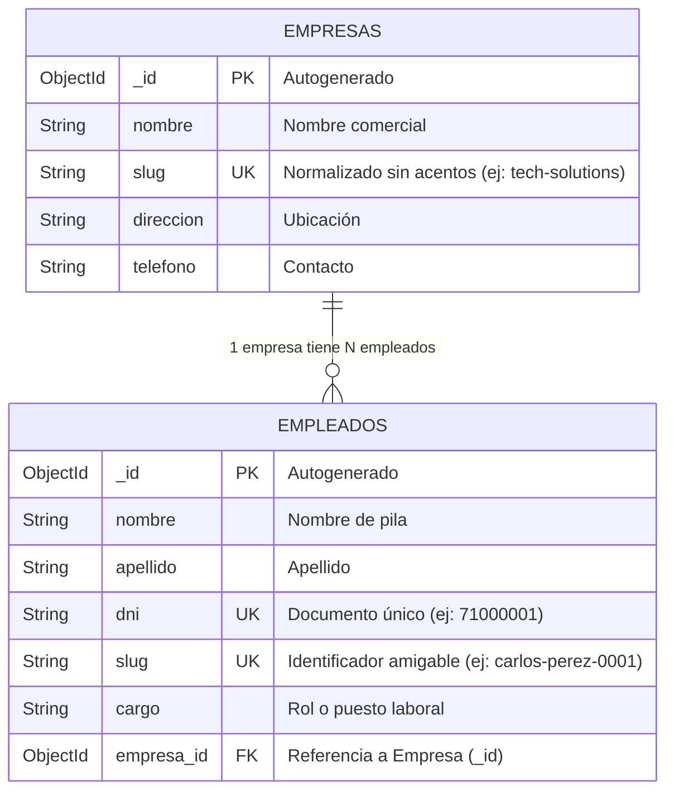

# 🏢 API REST: Gestión de Empresas y Empleados (Node.js + Express + MongoDB)

API REST modular y segura desarrollada con **Node.js**, **Express** y **Mongoose**, implementando modelado de relaciones **1 a N (1:N)**, persistencia en **MongoDB Community Server**, seguridad HTTP con **Helmet**, logging con **Morgan**, y soporte para URLs amigables (**Slugs** y **DNI**).

---

## 📁 Estructura del Proyecto

```text
mi-api/
├── .env                  # Variables de entorno (puerto y URI de conexión a MongoDB)
├── package.json          # Metadatos del proyecto, dependencias y scripts de ejecución
├── index.js              # Servidor principal Express, middlewares y conexión a MongoDB
├── seed.js               # Script para inicializar y poblar la base de datos con datos de prueba
├── models/
│   ├── Empresa.js        # Modelo Mongoose de Empresa (con generación automática de Slug)
│   └── Empleado.js       # Modelo Mongoose de Empleado (con DNI, Slug y referencia a Empresa)
└── routes/
    ├── empresaRoutes.js  # Endpoints para empresas (búsqueda por _id o por Slug)
    └── empleadoRoutes.js # Endpoints para empleados (búsqueda por _id, DNI o Slug con .populate)
```

---

## 🛠️ Tecnologías y Dependencias

* **Entorno:** [Node.js](https://nodejs.org/) (JavaScript Runtime)
* **Base de Datos:** [MongoDB](https://www.mongodb.com/) Community Server (v9.0.x)
* **Visualizador Gráfico:** MongoDB Compass
* **Framework Web:** [Express.js](https://expressjs.com/)
* **ODM (Modelado de Datos):** [Mongoose](https://mongoosejs.com/)
* **Middlewares y Utilidades:**
  * **`cors`:** Habilita el intercambio de recursos entre diferentes orígenes y puertos.
  * **`helmet`:** Blindaje de seguridad HTTP (oculta cabeceras sensibles y previene ataques comunes).
  * **`morgan`:** Logger de peticiones HTTP en consola en tiempo real (formato dev con colores).
  * **`dotenv`:** Gestión segura de variables de entorno fuera del código fuente.
  * **`nodemon`:** Recarga en caliente del servidor durante el desarrollo al detectar cambios en disco.

---

## 🧠 Arquitectura y Modelo de Datos (1:N)

Una **Empresa** tiene muchos **Empleados**, y un **Empleado** pertenece a una única **Empresa**.



---

## 🚀 Puesta en Marcha

### 1. Requisitos Previos
* Tener instalado **Node.js** (v18 o superior).
* Tener el servicio de **MongoDB Server** activo en el puerto local estándar (`mongodb://localhost:27017`).

### 2. Instalación de Dependencias
Navega a la carpeta del proyecto e instala los paquetes:
```bash
cd mi-api
npm install
```

### 3. Configuración de Variables de Entorno (`.env`)
Verifica o crea el archivo `.env` en la raíz de `mi-api/`:
```env
PORT=3000
MONGO_URI=mongodb://localhost:27017/mi_empresa_db
```

### 4. Inicializar y Poblar la Base de Datos (`Seed`)
Ejecuta el script para limpiar y cargar automáticamente las empresas y empleados de prueba:
```bash
npm run seed
```

### 5. Iniciar el Servidor en Modo Desarrollo
```bash
npm run dev
```
El servidor quedará escuchando en `http://localhost:3000` con Nodemon y Morgan activos.

---

## 🌐 Endpoints y Rutas de la API

### 🏢 Empresas (`/api/empresas`)

| Método | Endpoint | Descripción | Ejemplo de URL |
| :---: | :--- | :--- | :--- |
| **`GET`** | `/api/empresas` | Lista todas las empresas registradas. | `http://localhost:3000/api/empresas` |
| **`GET`** | `/api/empresas/:identificador` | Obtiene una empresa por su **Slug amigable** o por su **`_id`**. | `http://localhost:3000/api/empresas/tech-solutions` |
| **`GET`** | `/api/empresas/:identificador/empleados` | Obtiene los empleados de esa empresa buscando por **Slug** o **`_id`**. | `http://localhost:3000/api/empresas/tech-solutions/empleados` |

### 👥 Empleados (`/api/empleados`)

| Método | Endpoint | Descripción | Ejemplo de URL |
| :---: | :--- | :--- | :--- |
| **`GET`** | `/api/empleados` | Lista todos los empleados con los datos de su empresa poblados (`.populate`). | `http://localhost:3000/api/empleados` |
| **`GET`** | `/api/empleados/:identificador` | Busca un empleado por su **DNI**, su **Slug** o su **`_id`**. | `http://localhost:3000/api/empleados/71000001` |
| **`GET`** | `/api/empleados/:identificador` | Búsqueda por Slug tipo perfil. | `http://localhost:3000/api/empleados/carlos-perez-0001` |

---

## 📜 Scripts de NPM

* **`npm run dev`**: Arranca el servidor con **Nodemon** (reinicio automático en cada guardado de archivo) y registro con **Morgan**.
* **`npm start`**: Arranca el servidor en modo estándar de producción con Node.js.
* **`npm run seed`**: Limpia y vuelve a cargar los datos de prueba en la base de datos `mi_empresa_db`.
