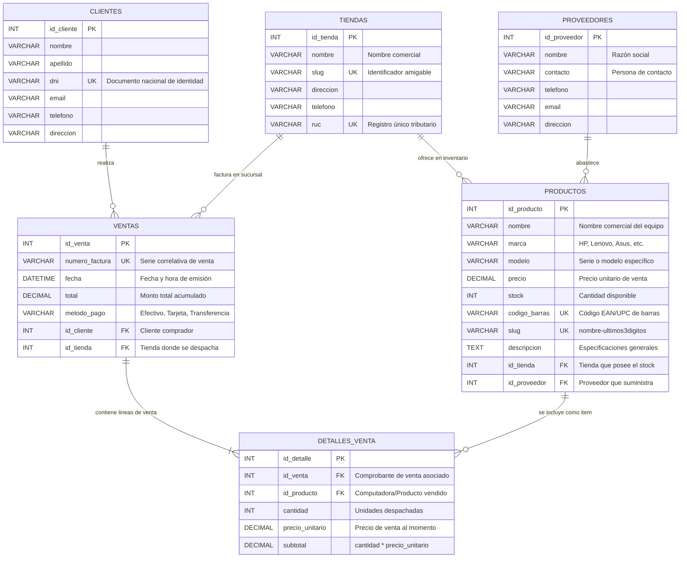

# Diseño Conceptual y Lógico: Sistema de Venta de Computadoras

* **Estudiante:** Omar Piero Terbullino Jaime
* **Código:** 72682019
* **Asignatura:** Ingeniería Web
* **Base de Datos:** `prueba_productos_db`

---

## 1. Diagrama Entidad-Relación (DER)

A continuación se representa el modelo conceptual de datos para el negocio de venta y distribución de computadoras y equipos tecnológicos:

---

## 2. Modelo Relacional (Esquema Lógico)

A partir del DER conceptual, se deriva el esquema relacional normalizado en Tercera Forma Normal (3FN):

1. **TIENDAS** (<u>id_tienda</u>, nombre, slug, direccion, telefono, ruc)
   * PK: `id_tienda`
   * Unique: `slug`, `ruc`

2. **PROVEEDORES** (<u>id_proveedor</u>, nombre, contacto, telefono, email, direccion)
   * PK: `id_proveedor`

3. **CLIENTES** (<u>id_cliente</u>, nombre, apellido, dni, email, telefono, direccion)
   * PK: `id_cliente`
   * Unique: `dni`

4. **PRODUCTOS** (<u>id_producto</u>, nombre, marca, modelo, precio, stock, codigo_barras, slug, descripcion, *id_tienda*, *id_proveedor*)
   * PK: `id_producto`
   * FK: `id_tienda` $\rightarrow$ TIENDAS(id_tienda)
   * FK: `id_proveedor` $\rightarrow$ PROVEEDORES(id_proveedor)
   * Unique: `codigo_barras`, `slug`

5. **VENTAS** (<u>id_venta</u>, numero_factura, fecha, total, metodo_pago, *id_cliente*, *id_tienda*)
   * PK: `id_venta`
   * FK: `id_cliente` $\rightarrow$ CLIENTES(id_cliente)
   * FK: `id_tienda` $\rightarrow$ TIENDAS(id_tienda)
   * Unique: `numero_factura`

6. **DETALLES_VENTA** (<u>id_detalle</u>, *id_venta*, *id_producto*, cantidad, precio_unitario, subtotal)
   * PK: `id_detalle`
   * FK: `id_venta` $\rightarrow$ VENTAS(id_venta) [ON DELETE CASCADE]
   * FK: `id_producto` $\rightarrow$ PRODUCTOS(id_producto) [ON DELETE RESTRICT]
